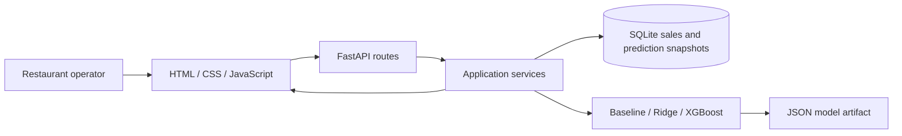

# Architecture
## Implemented system

The same application serves the frontend and API. The public route is hosted by Replit; local development uses a loopback server. There is no deployed RunPod call, live Orbyte integration, login, tenant boundary or role-enforced approval workflow in the audited main branch.

## Code responsibilities
| Path | Responsibility |
| --- | --- |
| `backend/main.py` | Application assembly, error handlers, API routes and frontend-only static serving |
| `backend/config.py` | Paths, import limits and UTC+8 business date |
| `backend/database.py` | SQLite schema, transactions and connection lifetime |
| `backend/schemas.py` | Request validation and business constraints |
| `backend/routes/` | HTTP entry points |
| `backend/services/` | Import, forecasting persistence and feedback report orchestration |
| `backend/repositories/` | Parameterized SQL for dishes, sales and prediction snapshots |
| `forecasting/data.py` | CSV/XLSX parsing and row validation |
| `forecasting/features.py` | Shared historical features; excludes target/future sales |
| `forecasting/baseline.py` | Recent same-weekday mean with recent-history fallback |
| `forecasting/estimators.py` | Ridge and XGBoost fitting and JSON restoration |
| `forecasting/training.py` | Time-based validation and per-dish model selection |
| `forecasting/predictor.py` | Mode selection, stale-model fallback and prep-buffer calculation |
| `forecasting/evaluate.py` | MAE, RMSE, WAPE and signed bias |
| `forecasting/synthetic.py` | Reproducible fictional cafeteria data |
| `forecasting/synthetic_evaluation.py` | Rolling one-day temporal evaluation |
| `frontend/` | Page, styles, request handling, history and charts |
| `tests/` | Isolated synthetic-data regression checks |

## One forecast
1. The frontend sends the operator's conditions to the prediction endpoint.
2. The schema validates the inputs; history is read strictly before the target date.
3. A compatible model with a matching history fingerprint is used; otherwise the historical baseline is used with a warning.
4. Recommended prep is derived from the forecast and the operator's buffer using decimal-safe upward rounding.
5. Conditions, data cutoff, version, per-dish output and totals are saved as a snapshot.
6. The page displays the response; the CSV endpoint exports the saved result.

Creating a prediction saves it immediately. It is **not** an approval by an authorized manager. CSV export is not an external supplier order.

## Imports, training and feedback
Imports validate all rows before the transaction is saved. Duplicate date/dish pairs and inconsistent names reject the batch rather than silently overwriting history. Training reads a history snapshot and compares all three candidates on the same temporal validation segment. Model files are replaced atomically. Feedback matches forecasts and actual sales by date/dish and flags retrospective predictions.

SQLite contains dishes, sales and prediction snapshots. The audited schema has no approval, actor/role, tenant, inventory or purchase tables. A local supply prototype exists outside this main branch; it is not evidence of a deployed inventory module.

## Orbyte fit: proposed, not connected
Proposed reusable boundary: an SME hub sends a sales-import or daily-prep trigger and synthetic business context; PrepWise returns recommendations for an authorized owner/manager to approve; a resulting action and activity event return to the hub. Roles and identity may be simulated for this challenge. Document assumed interface fields, approval states, permitted actors, failure paths and tenant separation before claiming this end-to-end journey works.

## Storage limitation
Application data and model artifacts are local files in the running environment. Passing a local SQLite restart test does not demonstrate survival across Replit republishing, autoscale instances or machine replacement. A durable cloud data/model strategy and recovery test remain open.
